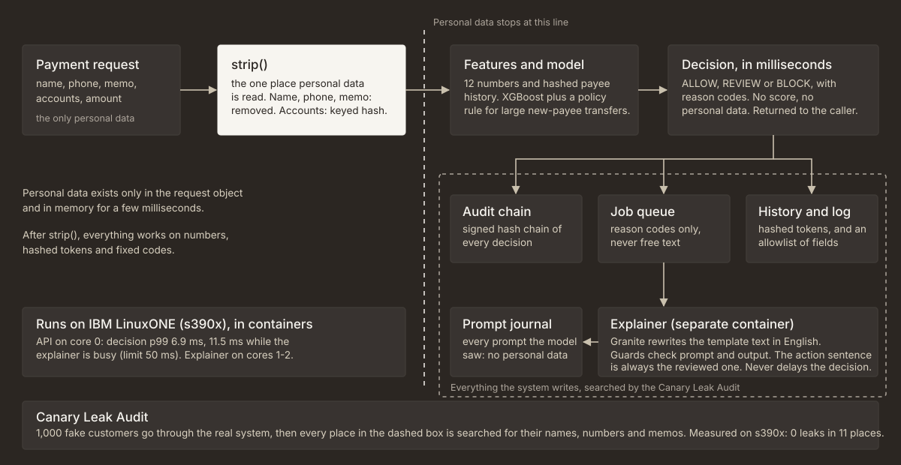
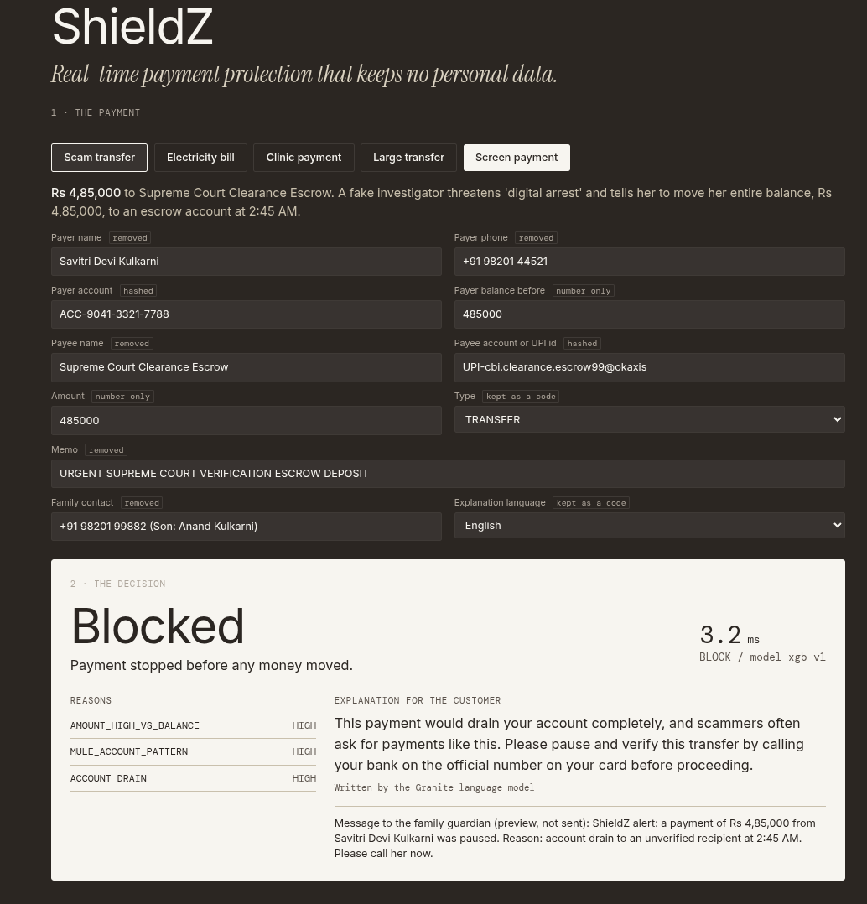
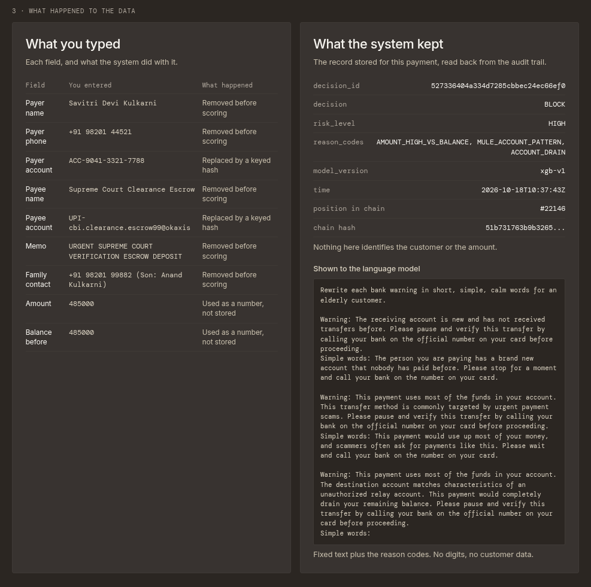
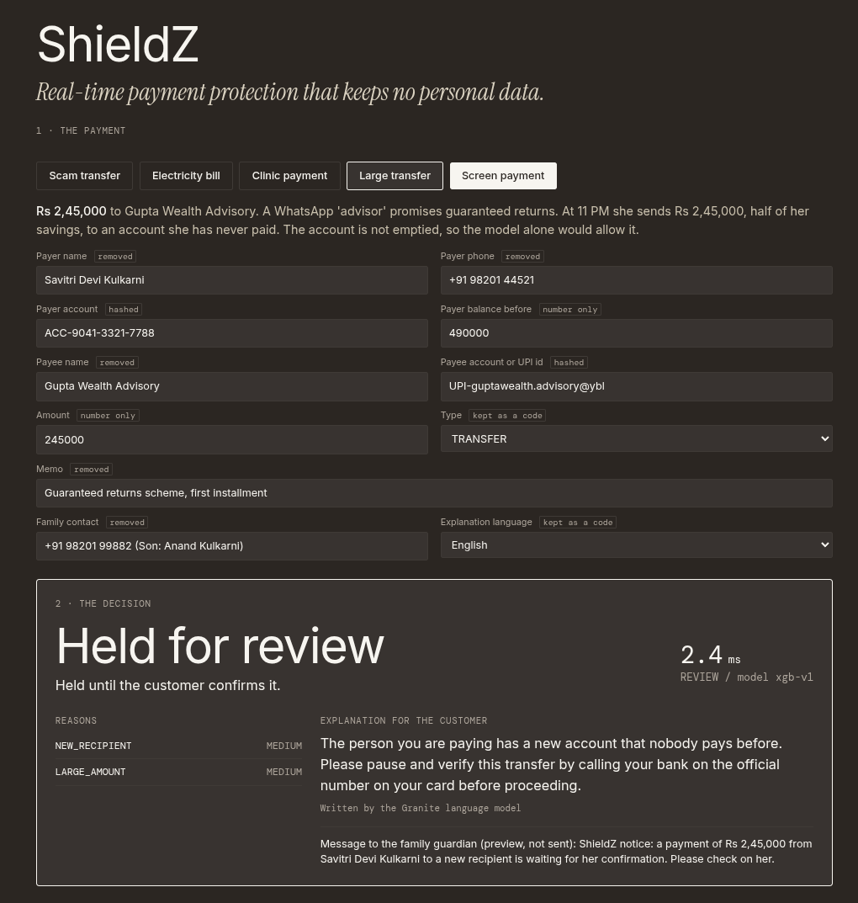
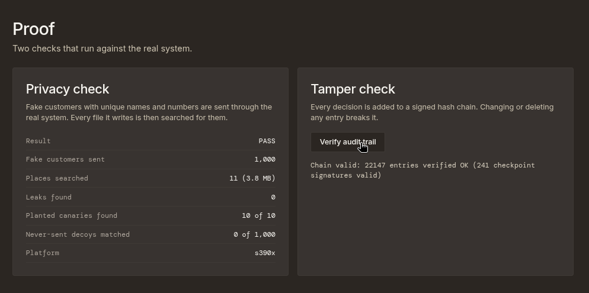
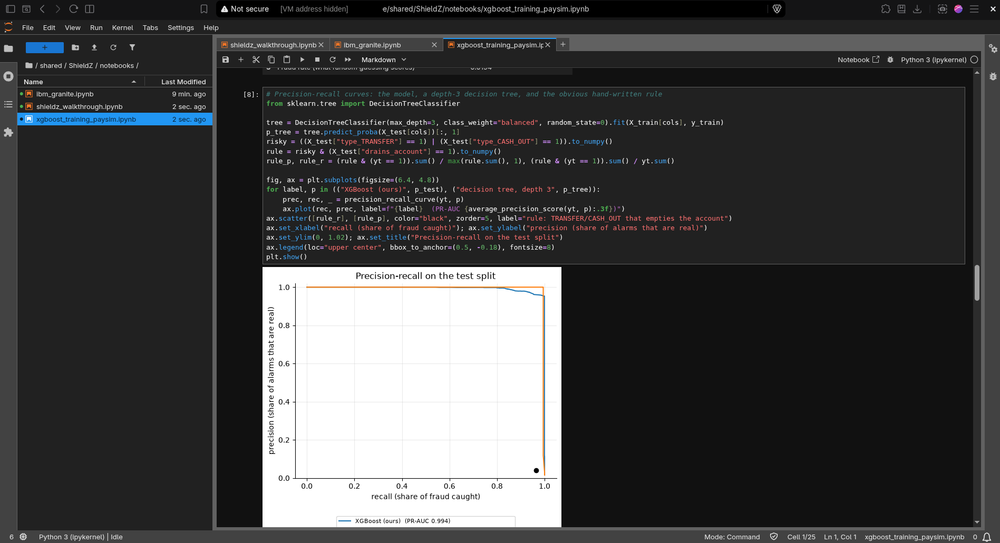
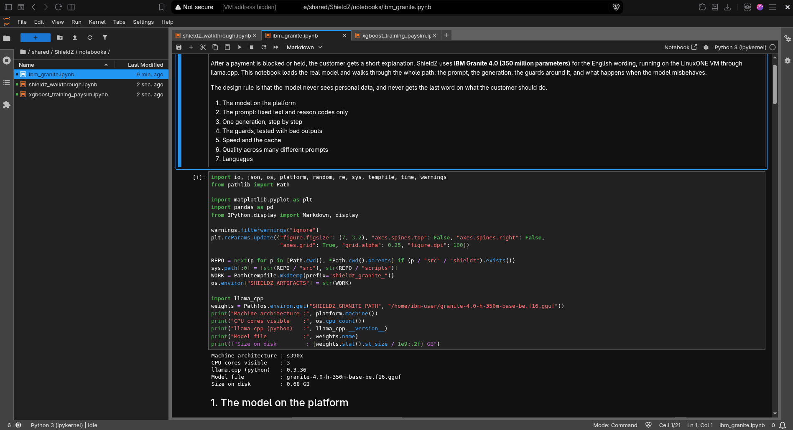

# ShieldZ

**Marauders_IBM Z Datathon 2026 Project** · Theme 2: *AI Secured: Innovation Without Exposure*

*Real-time payment protection that keeps no personal data. Built on IBM LinuxONE.*



## Problem statement

Payment scams hit elderly, rural and first-time digital users hardest, and instant payments (UPI, cards, wires) move money in seconds. Fraud AI has two gaps:
1. **Too slow.** A warning after the money has left is useless.
2. **Leaky.** Explaining a block usually means sending names, account numbers and amounts to an AI model or into logs. Fraud detection ends up creating a second privacy problem.

Sourced figures are listed under [Problem statistics](#problem-statistics-cited-in-the-pitch--video) below.

## Proposed solution

ShieldZ makes the decision first, in milliseconds, and keeps personal data out of everything that follows.

- **One door for personal data.** `strip()` is the only code that reads a payment's name, phone, memo and account numbers. It drops the first three and replaces accounts with keyed hashes. Everything after it works on numbers, hashed tokens and fixed reason codes.
- **A decision that never waits.** A trained model scores the payment and returns ALLOW, REVIEW or BLOCK with reason codes, in a few milliseconds. The explanation is written afterwards by a separate container.
- **An AI model that never sees personal data.** IBM Granite rewrites a reviewed template sentence from reason codes. A guard checks the prompt (fixed text, no digits) and the output, and the action sentence ("call your bank on the official number on your card") is always the reviewed one.
- **Proof, not a promise.** The **Canary Leak Audit** sends 1,000 fake customers through the real system and searches every place data lands for them.
- **A record that cannot be quietly rewritten.** Every decision goes into a hash-chained, Ed25519-signed audit trail.

## Key features

- **Real-time decisions:** p99 6.9 ms at one request at a time and 21.8 ms at eight, measured on s390x (limit: 50 ms).
- **Reason codes, not scores:** eight closed codes (for example `ACCOUNT_DRAIN`, `NEW_RECIPIENT`, `LARGE_AMOUNT`). The API never returns the score or any personal data.
- **Privacy you can see:** the demo page shows, for every payment, what you typed next to the record the system kept, and the exact prompt the language model was shown.
- **Language-model explanations with guard rails:** English from Granite, Hindi and Tamil from reviewed templates. If the model fails, loops or says something unsafe, the template is used.
- **Tamper-evident audit trail:** change or delete any entry and verification fails at that exact entry.
- **Platform fit:** API and explainer run as two Docker containers pinned to separate cores of one s390x machine, next to where the data lives.

## Results

All numbers come from files in [`results/`](results/) and were produced on the LinuxONE VM unless noted.

| What | Result | File |
|---|---|---|
| Decision latency, idle | p99 **6.9 ms** (1 at a time), **21.8 ms** (8 at a time); 5,000 requests each | `latency_real.json` |
| Decision latency while Granite is generating | p99 **11.5 ms** and **23.4 ms**, 0 errors | `latency_busy.json` |
| Privacy: Canary Leak Audit | **0 leaks** in 11 places (3.76 MB); planted canaries found 10 of 10; never-sent decoys matched 0 of 1,000 | `leak_scorecard_linuxone.md` |
| Tamper-evident audit trail | 22,086 entries and 190 signatures verified; one append costs p99 0.033 ms | `audit_verify_linuxone.txt`, `audit_append_bench.txt` |
| Granite explanations | 29 of 30 distinct prompts pass the guards; 10 s per fresh generation, instant when cached | `granite_quality.md` |
| Detector | PR-AUC 0.994 and recall 0.999 at 1% false alarms on a time-based holdout | `MODEL_CARD.md` |
| Training on LinuxONE | full PaySim (6.36 million rows) loaded in 16 s and trained in 19 s on 3 cores; the run reproduces the model card | `notebooks/xgboost_training_paysim.ipynb` |
| Demo payments (real model) | scam transfer BLOCK 3.8 ms; electricity bill ALLOW 1.5 ms; clinic payment ALLOW 1.4 ms; large transfer to a new account REVIEW 1.6 ms | `z_demo_run.txt` |
| Tests | 140 automated test cases, including the privacy, tamper and guard checks | `tests/` |

**A note on the detector.** PaySim fraud is close to a threshold pattern: a depth-3 decision tree matches our model (`results/baseline_comparison.md`). We do not claim detection accuracy as the contribution. The contribution is the pipeline around the model.

## Screenshots

Taken from the running system on the LinuxONE VM.

**A scam transfer, screened in 3 ms.** The decision comes back first. Every field is tagged with what happens to it, and the explanation is written by Granite.



**What happened to the data.** On the left, what was typed. On the right, the record the system kept and the exact prompt the language model was shown: fixed text and reason codes, no personal data.



**A large transfer to a new account is held for review.** The model alone would allow it, so a small policy rule holds it.



**The two proofs, run against the real system.** The privacy check (0 leaks, canaries found 10 of 10, decoys matched 0 of 1,000) and the tamper check (the whole signed chain re-verified).



**The training and Granite notebooks, open in JupyterLab on the VM.**





## Tech stack

| Layer | Technology |
|---|---|
| Platform | IBM LinuxONE Community Cloud (s390x), Ubuntu 24.04, Docker, the L1CC Jupyter ML image |
| Language and service | Python 3.12, FastAPI, Uvicorn, Pydantic |
| Detector | XGBoost (JSON model, ONNX export), scikit-learn, pandas, NumPy; trained on PaySim |
| Explanations | IBM Granite 4.0 350M through llama.cpp (CPU) |
| Storage | SQLite in WAL mode (job queue, payee history), JSON-lines files (audit chain, prompt journal) |
| Cryptography | HMAC-SHA256 account tokens; Ed25519 checkpoint signatures (system `python3-cryptography` on s390x, pure-Python RFC 8032 fallback) |
| Front end | Plain HTML, CSS and a little JavaScript, served by the API |
| Quality | pytest (140 cases), ruff, golden-file parity tests, a fuzz test for the prompt guard |

## Running it

On a laptop (no Docker needed):

```bash
uv venv --python 3.12 && uv pip install -r requirements/local-dev.txt
make test          # unit tests
make leak-audit    # canary leak audit (rule-based stand-in engine on a laptop)
```

On the LinuxONE VM:

```bash
make z-build && make z-up                  # build the image, start the API and the explainer
ssh -N -L 8000:localhost:8000 linux1@<vm-ip>   # then open http://localhost:8000/
bash scripts/z_evidence.sh                 # reproduce the VM evidence in results/
```

## Notebooks

Three notebooks, each saved **with its outputs from the LinuxONE VM (s390x)**, so they can be read on GitHub without running anything. They call the project's own code (`shieldz`) and only add the explanation and the plots. All three work in a scratch folder and never touch the deployed model or the live demo.

| Notebook | What it shows |
|---|---|
| [`notebooks/shieldz_walkthrough.ipynb`](notebooks/shieldz_walkthrough.ipynb) | The whole story step by step: one payment and what the system kept, the four demo payments, what the model alone would decide versus the policy rule, real-time latency, a live Canary Leak Audit, and tamper detection. |
| [`notebooks/xgboost_training_paysim.ipynb`](notebooks/xgboost_training_paysim.ipynb) | Training the detector on the VM: the full PaySim dataset (6.36 million rows) loads in 16 s and trains in 19 s on 3 cores, and reproduces the model card exactly. Plots: fraud by type and by day, learning curve, precision-recall curve, score distribution, feature importance, one payment's reason codes, the model against simple rules and tiny trees, and the confusion matrix. |
| [`notebooks/ibm_granite.ipynb`](notebooks/ibm_granite.ipynb) | IBM Granite 4.0 (350M) running on s390x: the prompt (fixed text, no digits), one generation step by step (what the model wrote, what is kept, what is dropped), the guards tested with bad outputs, the text cache, quality across many prompts, and why Hindi and Tamil use reviewed templates. |

To run them on the VM, open JupyterLab, go to `shared/ShieldZ/notebooks`, and use Kernel, then Restart Kernel and Run All Cells (each takes seconds to a couple of minutes).

## Repository map

| Path | What is in it |
|---|---|
| `src/shieldz/privacy/` | `strip()`, keyed tokens, allowlist logging |
| `src/shieldz/service/` | the API, the decision path, the policy rule, the demo page |
| `src/shieldz/model/`, `features/` | training, the XGBoost engine, reason codes, feature engineering |
| `src/shieldz/explainer/` | prompt builder, guards, template texts, Granite wrapper, worker |
| `src/shieldz/audit/` | hash chain, signed checkpoints, verification |
| `src/shieldz/leak_audit/` | canaries, scanner, sinks, scorecard |
| `notebooks/`, `tests/`, `scripts/`, `results/`, `docs/`, `containers/` | the three notebooks, tests, tools, committed evidence, the architecture document and diagram, the image |

Design and the rules that must hold: [docs/ARCHITECTURE.md](docs/ARCHITECTURE.md)

## Impact

- **Who it protects:** elderly, rural and first-time digital users, who lose the most to scams such as "digital arrest" calls.
- **Who it helps:** banks and payment providers that need fraud defense without creating a second store of customer data.
- **Goals it supports:** SDG 16 (target 16.4, reducing illicit financial flows) and SDG 8 (target 8.10, safer access to banking and financial services).

## Honest limits

- **Synthetic data.** The detector is trained on **PaySim**, which has no age or demographic fields. We claim that the **architecture** protects users and keeps data private. We do not claim measured accuracy for elderly users.
- **A simple model.** On this dataset a small decision tree matches it. A policy rule covers a case the model misses (a large partial transfer to a new payee).
- **Thresholds were tuned on the test split.** The review and block thresholds behind the model card's confusion matrix were chosen from the test split's scores, so that matrix is slightly optimistic. The headline metrics (PR-AUC, ROC-AUC, recall at 1% false alarms) use no thresholds and are unaffected. The training notebook re-chooses them on the validation split: 1,599 of 1,600 fraud cases are still caught or held, and the legitimate payments flagged are 56 blocks and 23 reviews (the model card shows 79 blocks).
- **English only for the language model.** The 350M model answers in English whatever it is asked, so Hindi and Tamil use reviewed templates.
- **Tamper-evident, not tamper-proof.** The audit trail reveals changes; it cannot prevent them. The newest entries since the last checkpoint cannot be proven complete.
- **The leak audit searches files.** It does not cover memory or the network.
- **The family message is a preview.** Nothing is sent.

## Future enhancements

- Run `strip` in a separate process in front of the API, so the API never holds raw data.
- Copy the signed audit checkpoints to separate storage.
- Real UPI payload formats and a larger, real-world fraud dataset.
- A language model that writes Hindi and Tamil, with the same guard rails.
- Use the platform's AI accelerator for the explainer.

## Team

Marauders: four members, working in a relay across the build window.

## Data and credits

All code was written during the event window (Oct 17–18, 2026). Datasets and open-source libraries used:

| Resource | Use | Link | Licence |
|---|---|---|---|
| PaySim (Kaggle) | Training / evaluation | https://www.kaggle.com/datasets/ealaxi/paysim1 | CC BY 4.0 |
| IBM LinuxONE Community Cloud + Jupyter Lab ML image | Platform | https://github.com/linuxone-community-cloud/jupyter-lab-ml | Apache-2.0 / Community |
| IBM Granite Foundation Models | Explanations | https://github.com/ibm-granite/granite-3.0-language-models | Apache-2.0 |
| XGBoost | Model | https://github.com/dmlc/xgboost | Apache-2.0 |
| llama.cpp / llama-cpp-python | LLM runtime | https://github.com/abetlen/llama-cpp-python | MIT |
| FastAPI, Uvicorn, Pydantic | Service | https://fastapi.tiangolo.com | MIT / BSD |
| Faker | Canary generation | https://github.com/joke2k/faker | MIT |
| pandas, NumPy, scikit-learn | Data / metrics | https://pandas.pydata.org | BSD |
| ONNX, onnxmltools | Model export | https://onnx.ai | Apache-2.0 |
| pytest | Tests | https://pytest.org | MIT |

_Add a row for every new library (rule 5 of the event)._

### Problem statistics cited in the pitch & video:
Checked against the sources below on 18 Oct 2026. Where a figure comes from a news report of an official dataset, the report is linked.
1. **Reserve Bank of India, Annual Report 2023–24 (frauds of ₹1 lakh and above):** 36,075 bank frauds were reported in FY24. Of these, **29,082 were card and internet (digital payment) frauds, involving ₹1,457 crore**, about 81% of the cases by number ([Rajya Sabha answer quoting the RBI table](https://rsdebate.nic.in/bitstream/123456789/757795/1/PQ_267_04022025_U239_p357_p357.pdf), [Inc42](https://inc42.com/buzz/online-fraud-cases-surged-334-yoy-in-fy24-says-rbi)).
2. **Indian Cyber Crime Coordination Centre (I4C, MHA), January to April 2024:** about **₹1,776 crore** lost across four cyber-fraud categories (trading, investment, "digital arrest" and romance scams), of which **₹120.30 crore** was lost to "digital arrest" scams. These are reported losses, not a complete count ([The Wire](https://thewire.in/news/indians-lost-rs-120-crore-in-digital-arrest-frauds-in-first-quarter-of-2024-report)).
3. **U.S. Federal Trade Commission, Consumer Sentinel 2023:** consumers reported losing a record **$10 billion** to fraud, **$2.7 billion** of it to imposter scams. Reported median loss for people aged 80 and over was **$1,450**, against $500 for ages 60 to 69 ([FTC](https://www.ftc.gov/node/86563), [ABA Banking Journal](https://bankingjournal.aba.com/2024/11/ftc-older-adults-lost-up-to-61-5b-to-fraud-in-2023/), [AARP](https://www.aarp.org/money/scams-fraud/info-2024/2023-ftc-consumer-losses)).
4. **National Crime Records Bureau, Crime in India 2022:** 65,893 cybercrime cases were registered, up 24.4% from 52,974 in 2021, and **64.8%** of them (42,710) were for fraud ([BOOM, citing the NCRB report](https://www.boomlive.in/explainers/telangana-records-most-cyber-crime-cases-for-the-second-time-in-a-row-shows-ncrb-report-23757)).
