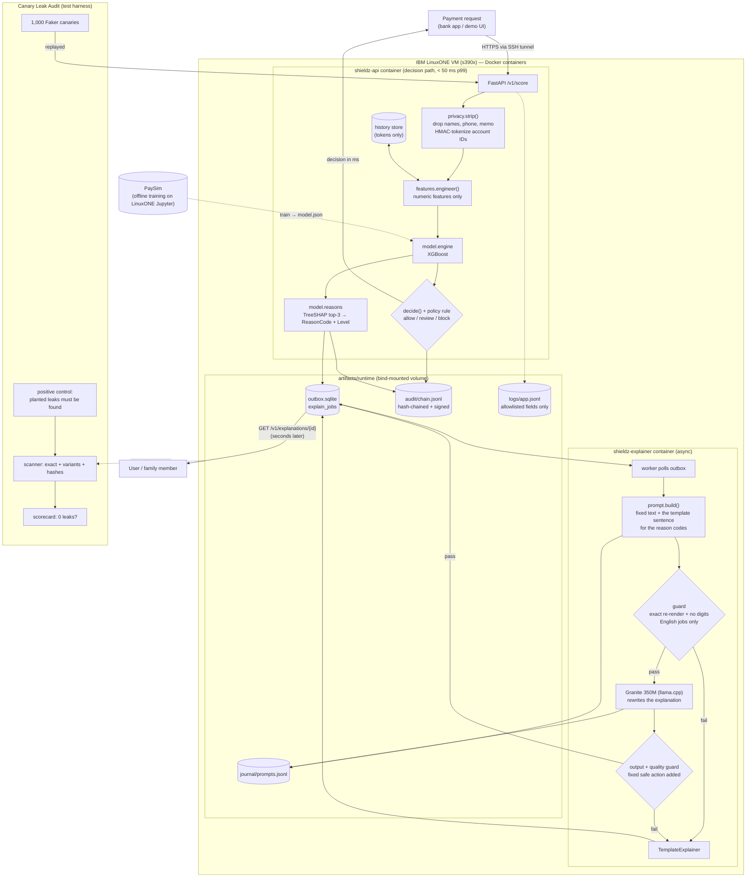

# ShieldZ — System Architecture

How the parts connect, what each one does, and the rules that must hold after every change.

---

## 1. Overview

ShieldZ has two pipelines and two cross-cutting layers, all running on the **LinuxONE** Community Cloud (**s390x**):

| Part | Runs | Job | Speed budget |
|---|---|---|---|
| **Decision path** (synchronous) | `shieldz-api` container | Strip PII → features → XGBoost score → allow/review/block (plus a policy rule) → reason codes | **< 50 ms p99** end to end (measured: 6.9 ms idle) |
| **Explainer** (asynchronous) | `shieldz-explainer` container | Reason codes → reviewed template text at once, then Granite rewrites it in English | Seconds; never blocks the decision |
| **Audit trail** | inside the decision path | Hash-chained, Ed25519-signed record of every decision | ≤ 1 ms p99 added |
| **Canary Leak Audit** | test harness | Replays 1,000 fake identities and scans every place data lands | Minutes; run at every gate |

The design rests on one idea: **personal data is removed at the very first step, and everything after that step works on data that cannot identify a person.** We don't just state this. The Leak Audit measures it.

---

## 2. Component diagram



---

## 3. Request lifecycle (decision path)

| # | Step | Code | What leaves the step |
|---|---|---|---|
| 1 | Validate request | `contracts.PaymentRequest` | Validated object (still has PII) |
| 2 | **Strip PII** | `privacy.strip()` | `FeatureInput`: tx type, amount, payer balance before, timestamp, `payee_token`, `payer_token`. Names, phone, memo and family contact are dropped. Account IDs become **HMAC** tokens |
| 3 | Engineer features | `features.engineer()` | `FeatureVector` (numbers only) |
| 4 | Score | `model.engine` | Probability (kept in memory, never logged or returned) |
| 5 | Decide | `service.decide` | `ALLOW` / `REVIEW` / `BLOCK` + risk level. After the model's thresholds, a **policy rule** raises an ALLOW to REVIEW when the payee is new **and** the amount is at least 40% of the balance **and** at least Rs 10,000 (the model learned full account drains and scores a large partial transfer low). It never lowers a decision. |
| 6 | Explain the score | `model.reasons` | Up to 3 `(ReasonCode, Level)` pairs (REVIEW/BLOCK only) |
| 7 | Audit append | `audit.chain` | Entry with codes, decision, model version, prev hash (hash only; signing happens in a background thread) |
| 8 | Enqueue | `outbox.queue` | `explain_jobs` row with codes/levels/language only |
| 9 | Respond | FastAPI | `Decision` (no PII, no exact score) + `server_ms` |

Steps 4–9 never see PII, because `privacy.strip()` is the only code that reads a `PaymentRequest`'s personal fields (the route handler and `Pipeline.handle` only pass the object along). This is enforced by the types and by a source-level test, `test_only_strip_reads_personal_fields`.

**Decision-time features only.** PaySim includes post-transaction columns (`newbalanceOrig`, `newbalanceDest`). A real bank does not know these before the payment executes. We **do not train on them**, so the model uses exactly what the service has at decision time:

| Feature | From | Notes |
|---|---|---|
| `type_TRANSFER`, `type_CASH_OUT`, `type_PAYMENT`, `type_CASH_IN`, `type_DEBIT` | `type` | One-hot |
| `log_amount` | `amount` | log1p |
| `amount_to_balance` | `amount / (oldbalanceOrg + 1)` | Core scam signal |
| `drains_account` | `amount >= oldbalanceOrg` | 0/1 |
| `payee_is_merchant` | `nameDest` starts with `M` (serving: payee type) | 0/1 |
| `payee_prior_inbound` | history store, counted chronologically; bucketed 0 / 1–3 / 4+ | Low = new/rarely used recipient. The store is **seeded at startup** (PaySim counts + demo seed), so a fresh service doesn't treat every payee as new |
| `payee_balance_before_zero` | `oldbalanceDest == 0` (if known) | Mule-account signal |
| `hour_of_day` | `step % 24` (serving: timestamp hour) | |

---

## 4. Reason codes

Closed set, defined once in `contracts.py`. The prompt builder, template explainer, audit log and UI all use this enum and nothing else.

| ReasonCode | Driven by feature(s) | Plain meaning (template, English) |
|---|---|---|
| `AMOUNT_HIGH_VS_BALANCE` | `amount_to_balance` | The payment uses most of the money in the account. |
| `ACCOUNT_DRAIN` | `drains_account` | The payment would leave the account empty. |
| `NEW_RECIPIENT` | `payee_prior_inbound` | The receiving account is new or rarely used. |
| `RISKY_TRANSFER_TYPE` | `type_TRANSFER`, `type_CASH_OUT` | This kind of transfer is often used in scams. |
| `MULE_ACCOUNT_PATTERN` | `payee_balance_before_zero` | The receiving account looks like one used to pass on stolen money. |
| `LARGE_AMOUNT` | `log_amount` | The amount is unusually large. |
| `UNUSUAL_TIME` | `hour_of_day` | The payment is at an unusual time. |
| `OTHER_PATTERN` | anything not mapped | Something else about the payment looks unusual. |

`NEW_RECIPIENT` and `LARGE_AMOUNT` are also what the policy rule reports when it holds a large transfer to a new payee.

`Level` ∈ {`LOW`, `MEDIUM`, `HIGH`} comes from fixed buckets on the feature value (e.g. `amount_to_balance` ≥ 0.9 → `HIGH`). Bucket edges live in `model/reasons.py` and are documented in the model card. **Codes and levels never contain numbers from the transaction.** A feature becomes a code only if its SHAP contribution is ≥ `MIN_CONTRIB` (start at +0.1 log-odds). If none qualifies, the code is `OTHER_PATTERN`.

The prompt (the only shape the guard accepts) is fixed text, two fixed examples, and the English template sentence chosen by the reason codes. A 350M base model cannot compose a warning from a list of codes (it looped or stated falsehoods in our tests), but it can rewrite text:
```
Rewrite each bank warning in short, simple, calm words for an elderly customer.

Warning: <fixed example 1, a template sentence for NEW_RECIPIENT>
Simple words: <fixed example answer>

Warning: <fixed example 2>
Simple words: <fixed example answer>

Warning: The receiving account is new and has not received transfers before. Please pause and
verify this transfer by calling your bank on the official number on your card before proceeding.
Simple words:
```
The model's answer is then post-processed: its explanation sentences are kept, **anything it says about what to do is dropped**, and the reviewed action sentence ("call your bank on the official number on your card") is appended. In our tests the model told customers to call "their number", which in a scam is the scammer's. Only English jobs go to the model; Hindi and Tamil use human-written templates, because the model answers in English whatever language it is asked for.

---

## 5. Where data lands (sinks)

Every one of these is registered in `leak_audit/sinks.py` and scanned. **If you add a new place where data is written, register it in the same PR** (invariant I6).

| Sink | Path / source | Written by |
|---|---|---|
| App log | `artifacts/runtime/logs/app.jsonl` | api, explainer |
| Container output | `docker logs shieldz-api`, `docker logs shieldz-explainer` | both |
| Outbox, explanations and the Granite text cache | `artifacts/runtime/outbox.sqlite` (all text columns, including the `llm_cache` table) | api, explainer |
| Audit chain | `artifacts/runtime/audit/chain.jsonl` | api |
| Prompt journal | `artifacts/runtime/journal/prompts.jsonl` | explainer |
| History store | `artifacts/runtime/history.sqlite` (+ `-wal`; shared by all api workers) | api |
| HTTP responses | captured by the replay client | api |
| Catch-all | every file under `artifacts/runtime/**` | anything |

---

## 6. Invariants (must hold after every change)

| ID | Invariant | Enforced by |
|---|---|---|
| I1 | Only `privacy.strip()` reads personal fields; nothing downstream can hold free text | Types; `tests/unit/test_strip.py` (including the source-level check) |
| I2 | The LLM prompt is fixed text plus the template sentence for the reason codes (the guard re-renders it and compares byte for byte); **no digits**; the output is checked for PII shapes, loops, contradictions and missing advice | `explainer/guard.py`; `tests/unit/test_explainer.py` (1,000 fuzzed prompts, injected names) |
| I3 | The decision path never waits on the LLM | Separate container and outbox; `results/latency_busy.json` |
| I4 | Logs use a field **allowlist**; unknown fields are dropped, not redacted | `privacy/redact_log.py`; the log PII test in `tests/unit/test_service.py` |
| I5 | Responses carry no PII and no exact score | Contract tests and `tests/unit/test_service.py` |
| I6 | Every sink is registered with the Leak Audit, and the catch-all walk covers the runtime dir | `leak_audit/sinks.py`; `test_live_replay_fills_every_sink_with_zero_leaks` |
| I7 | Audit entries are append-only and chained; any change is detectable | `audit/verify.py`; `tests/unit/test_audit.py` (modified, deleted, swapped, bad signature) |
| I8 | Every dependency runs on s390x (wheel, pure Python or preinstalled) | `scripts/check_deps.py` |
| I9 | Secrets (pepper, signing key) live only in `artifacts/keys/`, never in git | `.gitignore` |

---

## 7. File structure

Directories marked *(gitignored)* are never committed.

```
ShieldZ/
├── README.md                  # overview, results, how to run, credits
├── Makefile                   # test, lint, leak-audit, z-build, z-up, z-down, bench, verify
├── pyproject.toml             # package `shieldz` (src layout), pytest and ruff config
├── requirements/              # z-preinstalled (pins the laptop to the image), z-extra, local-dev
├── containers/                # Containerfile (one image, commands: api | explainer), entrypoint.sh
├── src/shieldz/
│   ├── contracts.py           # Pydantic schemas, enums, the Engine protocol: the shared contract
│   ├── config.py, clock.py    # paths and env vars; one timestamp format
│   ├── privacy/               # strip.py, tokenize.py (HMAC), redact_log.py (allowlist logging)
│   ├── features/              # engineer.py (train + serve), history.py (token-keyed store), demo_seed.csv
│   ├── model/                 # data.py, train.py, evaluate.py, engine.py, reasons.py, export.py
│   ├── service/               # app.py, pipeline.py, decide.py (+ policy rule), serve.py, records.py,
│   │                          # stub_engine.py, live_replay.py, static/ (demo page)
│   ├── outbox/                # queue.py (SQLite WAL: jobs, explanations, Granite text cache)
│   ├── explainer/             # prompt.py, guard.py, template.py, granite.py, worker.py, journal.py
│   ├── audit/                 # chain.py, signing.py, verify.py, _ed25519_rfc8032.py
│   └── leak_audit/            # canaries.py, sinks.py, scanner.py, replay.py, scorecard.py, __main__.py
├── scripts/                   # benchmarks, demo scenarios, Granite quality checks, evidence collection
├── notebooks/                 # shieldz_walkthrough.ipynb, with outputs from the LinuxONE VM
├── tests/
│   ├── unit/                  # 15 files, 140 cases
│   └── golden/                # parity fixtures (features_v1.csv, predictions_v1.csv)
├── results/                   # committed evidence: metrics, latency, scorecards, model card, Granite quality
├── docs/                      # this file, and assets/ (architecture diagram, SVG and PNG)
├── data/                      # (gitignored) PaySim
└── artifacts/                 # (gitignored) model/, keys/, runtime/ (logs, sqlite, audit, journal)
```

---

## 8. Deployment topology on the LinuxONE VM

```
LinuxONE VM (s390x, Ubuntu 24.04, Docker)  — user linux1
│
├── ~/shared/ShieldZ/                 git clone (pull-only), data/ and artifacts/ live here
│
├── container "notebook"  (L1CC Jupyter image, --network host, port 38888)
│      mounts ~/shared → /home/jovyan/shared             → the walkthrough notebook runs the service in-process
│
├── container "shieldz-api"        (image shieldz:latest, FROM the same L1CC image)
│      --network host, --cpuset-cpus = API cores, listens on 127.0.0.1:8000 only
└── container "shieldz-explainer"  (same image, command "explainer")
       --network host, --cpuset-cpus = other cores, no port
   both mount ~/shared/ShieldZ/artifacts → /app/artifacts
```

- **No public API port.** Laptops reach the API with `ssh -L 8000:localhost:8000 linux1@<vm-ip>`. Only SSH (22) and Jupyter (38888, already opened during setup) are reachable from outside.
- The CPU split is computed from `nproc` by `make z-up` (our VM has 3 vCPUs: API on core 0, explainer on cores 1-2). During benchmarks, stop idle Jupyter kernels so they don't add noise.
- The commands are `make z-build`, `make z-up`, `make bench` and `make verify` (see the README).

---

## 9. Why this is a good fit for IBM Z

- Scoring and the language model run **next to the data on one machine**, so no personal data travels to an outside AI service, and there is no network hop to a scoring service in the 50 ms budget.
- XGBoost runs natively on s390x (the model is also exported to ONNX). Granite runs through llama.cpp on the **CPU** inside the explainer container. We did not use or measure the on-chip AI accelerator; the `nnpa` flag is present in `/proc/cpuinfo`, and that is all we claim.
- Containers with CPU pinning show **workload isolation**: the slow language model cannot hurt the fast decision path. Measured p99: 6.9 ms idle and 11.5 ms while the explainer is generating (limit 50 ms).
- Speed is not the argument: the same benchmark on a laptop gives a similar p99, because the model is tiny. The argument is **where the data lives and what never leaves it**.
- Evidence: `uname -m` → `s390x`, `notebooks/shieldz_walkthrough.ipynb`, `results/latency_*.json` and the leak scorecard, all produced on LinuxONE.
