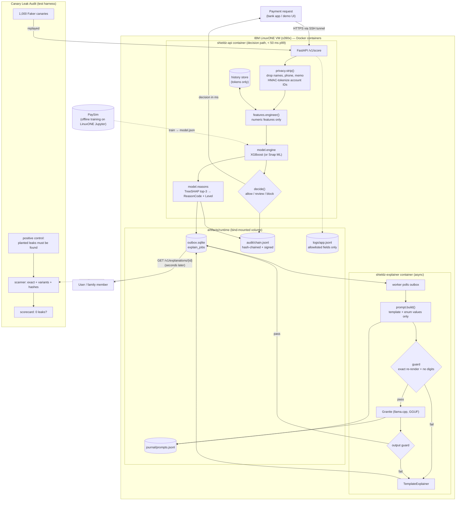

# ShieldZ — System Architecture

Terms in **bold** on first use are explained in [GLOSSARY.md](GLOSSARY.md). Build order and gates are in [IMPLEMENTATION_PLAN.md](IMPLEMENTATION_PLAN.md).

---

## 1. Overview

ShieldZ has two pipelines and two cross-cutting layers, all running on the **LinuxONE** Community Cloud (**s390x**):

| Part | Runs | Job | Speed budget |
|---|---|---|---|
| **Decision path** (synchronous) | `shieldz-api` container | Strip PII → features → XGBoost score → allow/review/block → reason codes | **< 50 ms p99** end to end |
| **Explainer** (asynchronous) | `shieldz-explainer` container | Reason codes → Granite → plain-language warning | Seconds; never blocks the decision |
| **Audit trail** | inside the decision path | Hash-chained, Ed25519-signed record of every decision | ≤ 1 ms p99 added |
| **Canary Leak Audit** | test harness | Replays 1,000 fake identities and scans every place data lands | Minutes; run at every gate |

The design rests on one idea: **personal data is removed at the very first step, and everything after that step works on data that cannot identify a person.** We don't just state this. The Leak Audit measures it.

---

## 2. Component diagram



---

## 3. Request lifecycle (decision path)

| # | Step | Code | What leaves the step |
|---|---|---|---|
| 1 | Validate request | `contracts.PaymentRequest` | Validated object (still has PII) |
| 2 | **Strip PII** | `privacy.strip()` | `FeatureInput`: tx type, amount, payer balance before, timestamp, `payee_token`, `payer_token`. Names, phone, memo and family contact are dropped. Account IDs become **HMAC** tokens |
| 3 | Engineer features | `features.engineer()` | `FeatureVector` (numbers only) |
| 4 | Score | `model.engine` | Probability (kept in memory, never logged or returned) |
| 5 | Decide | `service.decide` | `ALLOW` / `REVIEW` / `BLOCK` + risk level |
| 6 | Explain the score | `model.reasons` | Up to 3 `(ReasonCode, Level)` pairs (REVIEW/BLOCK only) |
| 7 | Audit append | `audit.chain` | Entry with codes, decision, model version, prev hash (hash only; signing happens in a background thread) |
| 8 | Enqueue | `outbox.queue` | `explain_jobs` row with codes/levels/language only |
| 9 | Respond | FastAPI | `Decision` (no PII, no exact score) + `server_ms` |

Steps 4–9 never see PII, because `privacy.strip()` is the only function that receives a `PaymentRequest`. This is enforced by type signatures and tested in the M1 gate.

**Decision-time features only.** PaySim includes post-transaction columns (`newbalanceOrig`, `newbalanceDest`). A real bank does not know these before the payment executes. We **do not train on them**, so the model uses exactly what the service has at decision time:

| Feature | From | Notes |
|---|---|---|
| `type_TRANSFER`, `type_CASH_OUT`, `type_PAYMENT`, `type_CASH_IN`, `type_DEBIT` | `type` | One-hot |
| `log_amount` | `amount` | log1p |
| `amount_to_balance` | `amount / (oldbalanceOrg + 1)` | Core scam signal |
| `drains_account` | `amount >= oldbalanceOrg` | 0/1 |
| `payee_is_merchant` | `nameDest` starts with `M` (serving: payee type) | 0/1 |
| `payee_prior_inbound` | history store, counted chronologically; bucketed 0 / 1–3 / 4+ | Low = new/rarely used recipient. The store is **seeded at startup** (PaySim counts + demo seed), so a fresh service doesn't treat every payee as new |
| `payee_balance_before_zero` | `oldbalanceDest == 0` (if known) | Mule-account signal |
| `hour_of_day` | `step % 24` (serving: timestamp hour) | |

---

## 4. Reason codes

Closed set, defined once in `contracts.py`. The prompt builder, template explainer, audit log and UI all use this enum and nothing else.

| ReasonCode | Driven by feature(s) | Plain meaning (template, English) |
|---|---|---|
| `AMOUNT_HIGH_VS_BALANCE` | `amount_to_balance` | The payment uses most of the money in the account. |
| `ACCOUNT_DRAIN` | `drains_account` | The payment would leave the account empty. |
| `NEW_RECIPIENT` | `payee_prior_inbound` | The receiving account is new or rarely used. |
| `RISKY_TRANSFER_TYPE` | `type_TRANSFER`, `type_CASH_OUT` | This kind of transfer is often used in scams. |
| `MULE_ACCOUNT_PATTERN` | `payee_balance_before_zero` | The receiving account looks like one used to pass on stolen money. |
| `LARGE_AMOUNT` | `log_amount` | The amount is unusually large. |
| `UNUSUAL_TIME` | `hour_of_day` | The payment is at an unusual time. |
| `OTHER_PATTERN` | anything not mapped | Something else about the payment looks unusual. |

`Level` ∈ {`LOW`, `MEDIUM`, `HIGH`} comes from fixed buckets on the feature value (e.g. `amount_to_balance` ≥ 0.9 → `HIGH`). Bucket edges live in `model/reasons.py` and are documented in the model card. **Codes and levels never contain numbers from the transaction.** A feature becomes a code only if its SHAP contribution is ≥ `MIN_CONTRIB` (start at +0.1 log-odds). If none qualifies, the code is `OTHER_PATTERN`.

Example prompt (the only shape the guard accepts):
```
Decision: BLOCK. Risk: HIGH.
Reasons:
- AMOUNT_HIGH_VS_BALANCE (HIGH): The payment uses most of the money in the account.
- NEW_RECIPIENT (HIGH): The receiving account is new or rarely used.
Language: English.
Write two or three calm, simple sentences warning an elderly customer. Suggest they pause and call their bank on the number printed on their card. Do not mention any numbers, names or links.
```

---

## 5. Where data lands (sinks)

Every one of these is registered in `leak_audit/sinks.py` and scanned. **If you add a new place where data is written, register it in the same PR** (invariant I6).

| Sink | Path / source | Written by |
|---|---|---|
| App log | `artifacts/runtime/logs/app.jsonl` | api, explainer |
| Container output | `docker logs shieldz-api`, `docker logs shieldz-explainer` | both |
| Outbox + explanations | `artifacts/runtime/outbox.sqlite` (all text columns) | api, explainer |
| Audit chain | `artifacts/runtime/audit/chain.jsonl` | api |
| Prompt journal | `artifacts/runtime/journal/prompts.jsonl` | explainer |
| History store | `artifacts/runtime/history.sqlite` | api |
| HTTP responses | captured by the replay client | api |
| Catch-all | every file under `artifacts/runtime/**` | anything |

---

## 6. Invariants (must hold after every change)

| ID | Invariant | Enforced by |
|---|---|---|
| I1 | Only `privacy.strip()` receives PII; nothing downstream can hold free text | Types + M1 PII barrier test |
| I2 | The LLM prompt is exactly the fixed template rendered with enum values (the guard re-renders and compares byte for byte); **no digits** in variable parts | `explainer.guard` + M5 guard tests |
| I3 | The decision path never waits on the LLM | Separate container + outbox; M5 latency-isolation gate |
| I4 | Logs use a field **allowlist**; unknown fields are dropped, not redacted | `privacy.redact_log` + M3 log test |
| I5 | Responses carry no PII and no exact score | Contract tests |
| I6 | Every sink is registered with the Leak Audit, and the catch-all walk covers the runtime dir | Code review + M4 sink coverage check |
| I7 | Audit entries are append-only and chained; any change is detectable | `audit.verify` + M6 tamper tests |
| I8 | Every dependency runs on s390x (wheel, pure Python or preinstalled) | `scripts/check_deps.py`, [DECISIONS.md](DECISIONS.md) table |
| I9 | Secrets (pepper, signing key) live only in `artifacts/keys/`, never in git | `.gitignore` + M8 check |

---

## 7. File structure

Created in M0. Directories marked *(gitignored)* never get committed.

```
ShieldZ/
├── AGENTS.md                  # rules for AI agents and humans picking up work (read first)
├── README.md                  # public overview, run instructions, credits (required by rules)
├── progress.md                # live status + handoff log (update before you stop)
├── explanation.md             # plain-language notes per member/agent session
├── Makefile                   # test, lint, z-gate, z-up, leak-audit, bench, verify
├── pyproject.toml             # package `shieldz` (src layout), pytest + ruff config
├── requirements/
│   ├── z-preinstalled.txt     # versions that ship in the L1CC image (pins the laptop venv to match)
│   ├── z-extra.txt            # installed into our image: fastapi, uvicorn, faker, pytest (+snapml?)
│   └── local-dev.txt          # z-preinstalled + z-extra + ruff, llama-cpp-python (optional)
├── containers/
│   └── Containerfile          # FROM l1cc jupyterlab-image-s390x; commands: api | explainer
├── src/shieldz/
│   ├── contracts.py           # Pydantic schemas + ReasonCode/Level enums — the shared contract
│   ├── config.py              # paths, thresholds file, env vars
│   ├── privacy/               # strip.py, tokenize.py (HMAC), redact_log.py (allowlist logging)
│   ├── features/              # engineer.py (train + serve), history.py (token-keyed store)
│   ├── model/                 # data.py, train.py, evaluate.py, engine.py, reasons.py, export.py (LinuxONE operator)
│   ├── service/               # app.py (FastAPI), decide.py, static/ (demo UI)
│   ├── outbox/                # queue.py (SQLite WAL outbox)
│   ├── explainer/             # prompt.py, guard.py, template.py, journal.py (proof build); granite.py, worker.py (LinuxONE operator)
│   ├── audit/                 # chain.py, signing.py, verify.py (CLI)
│   └── leak_audit/            # canaries.py, sinks.py, scanner.py, replay.py, scorecard.py, __main__.py
├── scripts/
│   ├── z_doctor.py            # LinuxONE environment check (M0 and every gate)
│   ├── check_deps.py          # does this package exist for s390x?
│   ├── bench_latency.py       # p50/p95/p99 benchmark (run on the VM)
│   └── demo_scenarios.py      # the three demo stories
├── notebooks/                 # thin: import shieldz, show outputs (evidence for judges)
│   ├── 01_eda_paysim.ipynb
│   ├── 02_train_on_linuxone.ipynb
│   └── 03_explainer_granite.ipynb
├── tests/
│   ├── unit/                  # fast, run everywhere
│   ├── integration/           # TestClient end-to-end, leak audit on small runs
│   ├── golden/                # parity fixtures (features_v1.csv, predictions_v1.csv)
│   └── z/                     # @pytest.mark.z / llm — LinuxONE only
├── results/                   # committed: metrics, latency, scorecards, model card, sample outputs
├── docs/
│   ├── IMPLEMENTATION_PLAN.md  ARCHITECTURE.md  GLOSSARY.md
│   ├── GIT_WORKFLOW.md  LINUXONE_RUNBOOK.md  DECISIONS.md
│   └── assets/                # flowchart PNG, evidence screenshots
├── data/                      # (gitignored) PaySim CSV, local sample
└── artifacts/                 # (gitignored) model/, keys/, runtime/ (logs, sqlite, audit, journal)
```

---

## 8. Deployment topology on the LinuxONE VM

```
LinuxONE VM (s390x, Ubuntu 24.04, Docker)  — user linux1
│
├── ~/shared/ShieldZ/                 git clone (pull-only), data/ and artifacts/ live here
│
├── container "notebook"  (L1CC Jupyter image, --network host, port 38888)
│      mounts ~/shared → /home/ibm-user/shared        → notebooks import ../ShieldZ/src
│
├── container "shieldz-api"        (image shieldz:latest, FROM the same L1CC image)
│      --network host, --cpuset-cpus = API cores, listens on 127.0.0.1:8000 only
└── container "shieldz-explainer"  (same image, command "explainer")
       --network host, --cpuset-cpus = other cores, no port
   both mount ~/shared/ShieldZ/artifacts → /app/artifacts
```

- **No public API port.** Laptops reach the API with `ssh -L 8000:localhost:8000 linux1@<vm-ip>`. Only SSH (22) and Jupyter (38888, already opened during setup) are reachable from outside.
- The CPU split is computed from `nproc` by `make z-up` (runbook §5; e.g. 2 vCPUs → API `0`, explainer `1`). During benchmarks, stop idle Jupyter kernels so they don't add noise.
- Commands are in [LINUXONE_RUNBOOK.md](LINUXONE_RUNBOOK.md).

---

## 9. Why this is a good fit for IBM Z

- Scoring and generative AI run **next to the data on one machine**, so no personal data travels to an outside AI service.
- The L1CC image's llama.cpp is built with **zDNN/NNPA** (the on-chip AI accelerator) and OpenBLAS vector extensions. Granite inference uses the Z hardware directly.
- Snap ML (if adopted in M2) is IBM's tree-model inference library for Z.
- Containers with CPU pinning show **workload isolation**: the slow LLM cannot hurt the fast decision path.
- Evidence for the video: `uname -m` → `s390x`, `docker stats`, the Jupyter training notebook, `results/latency_*.json` and the leak scorecard, all produced on LinuxONE.
