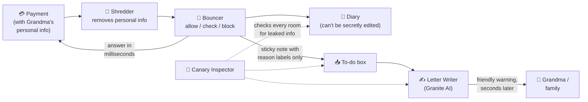

# 🐒 Monkey Brain: ShieldZ Explained Simply

> The whole project, technical parts included, explained so anyone can follow it. No prior knowledge needed.
> For the precise version see [docs/ARCHITECTURE.md](docs/ARCHITECTURE.md); for single words, [docs/GLOSSARY.md](docs/GLOSSARY.md).

---

## 1. The story in 30 seconds

👵 Grandma gets a phone call: *"This is your bank. Your account is hacked! Move all your money to this safe account RIGHT NOW."*
She panics and opens her payment app. In 5 seconds her savings would be gone forever.

🛡️ **ShieldZ** steps in at the moment she presses "Send":

```
   Grandma presses SEND
          │
          ▼
   ┌───────────────┐   in less time than a blink   ┌──────────────────────┐
   │  ShieldZ      │ ────────────────────────────▶ │ ⛔ PAYMENT PAUSED     │
   │  checks it    │                               └──────────────────────┘
   └───────────────┘
          │  a few seconds later
          ▼
   ┌───────────────────────────────────────────────────────────────────┐
   │ 💬 "This payment would empty your account and is going to a       │
   │     brand-new account. Banks never ask you to move money to       │
   │     keep it safe. Please call your bank on the number on your     │
   │     card before continuing."                                      │
   └───────────────────────────────────────────────────────────────────┘
```

**The twist:** the AI that writes that friendly message **never learns who Grandma is**. It never sees her name, phone number, account number or how much money she has. And we don't just *say* that. We **prove** it with a test.

---

## 2. The big picture: five characters

Think of ShieldZ as a small team of workers inside a bank vault:

| Character | Real name in the project | Job |
|---|---|---|
| 🧹 **The Shredder** | `privacy.strip()` | Stands at the door and removes everything personal from the payment |
| 🚪 **The Bouncer** | the XGBoost model + decision service | Decides *allow / check / block* super fast |
| ✍️ **The Letter Writer** | IBM Granite (an AI that writes text) | Writes the friendly warning, slowly, in a back room |
| 📔 **The Diary Keeper** | the hash-chained audit log | Writes down every decision in a diary nobody can secretly change |
| 🐤 **The Canary Inspector** | the Canary Leak Audit | Sends 1,000 fake people through and checks that no personal info leaked anywhere |



All of this runs on one machine: an **IBM LinuxONE** computer (more on that in §9).

---

## 3. 🧹 The Shredder: personal info stops at the door

A payment arrives looking like this:

```
┌─────────────────────────────── incoming payment ──────────────────────────────┐
│ From:   Kamala Devi   📞 +91 98765 43210   account 5021 3344 7788             │
│ To:     "Safe Account" account 9001 2222 3333                                  │
│ Amount: ₹48,250   Balance before: ₹48,300   Note: "urgent RBI safety transfer" │
└────────────────────────────────────────────────────────────────────────────────┘
```

The Shredder's rules:

```
  Name            "Kamala Devi"        ──▶  🗑️  thrown away
  Phone           "+91 98765 43210"    ──▶  🗑️  thrown away
  Note            "urgent RBI..."      ──▶  🗑️  thrown away
  Account numbers "5021 3344 7788"     ──▶  🔒  replaced with a secret code "a9f3…"
  Amount/balance  ₹48,250 / ₹48,300    ──▶  🔢  turned into plain numbers for the Bouncer only
```

**What's the "secret code" for account numbers?** (the technical name is **HMAC**)
Picture a rubber stamp that only our bank owns. Stamp an account number with it and you get a jumble like `a9f3c1…`.
- The same account always gets the same jumble, so we can still notice "this person has never paid this account before".
- Without our stamp you can't work backwards from the jumble to the account number.
- ⚠️ Why not just scramble it with a normal, stamp-free scrambler? Because a crook could scramble *every possible* account number and compare the results. The secret stamp (the "pepper") stops that.

After the Shredder, **nobody downstream ever sees personal info again**. That's the most important rule in the project.

---

## 4. 🚪 The Bouncer: deciding in under 50 milliseconds

### How fast is 50 ms?

```
 Blink of an eye      ████████████████████████████████████████  ~300 ms
 ShieldZ target       ██████▌                                    < 50 ms   (for 99 out of 100 payments)
```

**"p99 < 50 ms"** means: line up 100 payments; at least 99 of them get an answer in under 50 ms. We measure the slow ones too, not just the average.

### How did the Bouncer learn?

We showed it **6.3 million practice payments** from a dataset called **PaySim**. They're computer-made, not real people, and each one is labelled "fraud" or "normal". The Bouncer looked for patterns.

It doesn't look at raw payments. It looks at **clues** (called *features*):

| Clue | Grandma's payment | Why it matters |
|---|---|---|
| How much of the balance is being sent? | 99.9% 😱 | Scammers make people send *everything* |
| Does it empty the account? | Yes | Same reason |
| Has this receiving account received money before? | Never | Scam accounts are often brand-new |
| Type of payment | Transfer | Scams use transfers, not shop payments |
| Time of day | 11 pm | Odd hours are a bit suspicious |

### What kind of brain is it? Many small decision trees (**XGBoost**)

One decision tree is like a game of 20 questions:

```
                 Sending more than 90% of balance?
                    /                        \
                  yes                         no
                  /                             \
     Receiver never paid before?          Amount unusually large?
         /            \                      /            \
       yes             no                  yes             no
        │               │                   │               │
   +2.5 risk        +0.8 risk           +0.6 risk       −1.0 risk
```

**XGBoost** builds **hundreds** of these small trees. Each new tree focuses on the mistakes of the trees before it. Their answers are added up into one risk score.

```
 tree 1: +2.5   tree 2: +0.9   tree 3: +1.1   …   tree 300: +0.2
 ─────────────────────────────────────────────────────────────▶  total → risk 0.97
```

Answering is just walking down a few hundred tiny trees, which is why it's so fast.

### From score to decision

```
 risk 0.0 ────────────────── t_review ─────────── t_block ──────── 1.0
          ✅ ALLOW                     🟡 REVIEW              ⛔ BLOCK
                                                             ▲ Grandma: 0.97
```

### A trap we avoided: no "cheating clues"

PaySim also contains the balance **after** the payment happened. That's like grading a test by peeking at the answer key: a real bank doesn't know the "after" balance *before* deciding. Using it would make our scores look amazing and be completely fake. So we don't use it. (The technical name for this trap is **data leakage**.)

---

## 5. 🧾 Why did it say that? SHAP and reason codes

The Bouncer says "0.97 risk", but *why*? We use a method called **SHAP**. Think of it as **splitting a restaurant bill fairly**: the total risk is the bill, and SHAP works out how much each clue "ordered".

```
 Starting risk (average payment)   ▏ low
 + sends 99.9% of balance          ███████████████  biggest share
 + receiver is brand new           ██████████
 + it's a transfer                 █████
 + 11 pm                           █
 ──────────────────────────────────────────────
 = final risk                      very high → BLOCK
```

We take the **top 3** and turn them into fixed **labels** called **reason codes**:

```
  "sends 99.9% of balance"   ──▶  AMOUNT_HIGH_VS_BALANCE (HIGH)
  "receiver is brand new"    ──▶  NEW_RECIPIENT (HIGH)
  "it's a transfer"          ──▶  RISKY_TRANSFER_TYPE (MEDIUM)
```

Notice what's **not** in the labels: no ₹48,250, no names, no account numbers. Just words from a fixed list of 8. It's like a doctor writing "fever: high" instead of the patient's full medical file.

---

## 6. ✍️ The Letter Writer: Granite gets only sticky notes

The Letter Writer is **IBM Granite**, an AI that writes text (a "large language model", or LLM). It's smart but **slow** (seconds, not milliseconds) and **chatty**: anything you tell an AI might end up somewhere you didn't expect.

So we give it **only a sticky note**:

```
 ┌────────────────────────────────────────────┐
 │ 📝 Decision: BLOCK. Risk: HIGH.             │
 │    - AMOUNT_HIGH_VS_BALANCE (HIGH)          │
 │    - NEW_RECIPIENT (HIGH)                   │
 │    Language: English                        │
 │    Write 2-3 calm sentences for an elderly  │
 │    customer. No numbers, names or links.    │
 └────────────────────────────────────────────┘
```

### The guard at the back-room door 💂

Before any sticky note reaches Granite, a guard checks it:

```
 Is it in the exact sticky-note format?        ✅ / ❌
 Are all the labels from our list of 8?        ✅ / ❌
 Is it EXACTLY what our template would print   ✅ / ❌
   for these labels? (re-print and compare)
 Does it contain ANY digit (0-9)?              ❌ must be none!
```

Why "no digits at all"? Phone numbers, account numbers and amounts **all contain digits**. One simple rule blocks all of them. And because the guard re-prints the note itself and compares, a **name** or any other sneaky text can't slip in either, even though names have no digits. If anything looks wrong, the guard refuses, and a pre-written template message is used instead.

A second guard checks Granite's **answer**. If it contains anything that looks like personal data (long numbers, money amounts, phone numbers), links or "@", we throw it away and use the template. Small harmless numbers like "24 hours" are fine. We also count how often Granite's answer is accepted, so we can't secretly be showing templates all the time. An AI that invents a phone number or a link would look exactly like a scam!

### Why a separate back room? (**asynchronous** + **outbox**)

```
  Front desk (Bouncer)                      Back room (Letter Writer)
  ┌───────────────────┐   drops a note     ┌───────────────────────┐
  │ decides in 20 ms, │ ─────────────────▶ │ 📥 to-do box           │
  │ answers instantly │   then moves on    │ picks notes up one by │
  └───────────────────┘                    │ one, writes letters   │
                                           └───────────────────────┘
```

The Bouncer **never waits** for the Letter Writer. Grandma's payment is paused in milliseconds; the explanation arrives a few seconds later. The "to-do box" is a small database file (SQLite) called the **outbox**.

They also sit on **different CPU cores** (**CPU pinning**). It's like giving the ambulance its own lane: the slow writer can't cause a traffic jam for the fast bouncer.

---

## 7. 🐤 The Canary Inspector: proving nothing leaked

### Where the name comes from

Coal miners used to carry a **canary** into the mine. Canaries react to poison gas before people do, so if the canary got sick, the miners knew there was danger they couldn't see.

### Our version

We invent **1,000 fake people**, each with super-unusual details nobody else would have:

```
 🐤 Canary #417
    Name:    Rukmini Venkataraghavan
    Phone:   +91 90031 47729
    Account: 7713 0042 9918
    UPI:     rukmini.v417@okbank
    Note:    "CANARY-7f3a9c"
    Amount:  ₹48,250.37      ← weird paise on purpose
```

We push all 1,000 through the **entire** system. Then we search **every room** for any trace of them:

```
  📂 log files        🔍 ─┐
  📂 the to-do box    🔍  │
  📂 the diary        🔍  ├──▶  Found any canary detail?  ──▶  📋 SCORECARD
  📂 Granite's notes  🔍  │                                      "0 leaks"
  📂 web responses    🔍  │
  📂 EVERY other file 🔍 ─┘   (even files nobody told us about)
```

### Leaks in disguise 🥸

A sneaky leak might not look like the original. We search for disguises too:

```
 Original:        +91 90031 47729
 No spaces:       +919003147729
 Digits only:     919003147729
 Base64:          Kzkx…            (a way computers re-write text)
 Hex:             2b3931…          (another one)
 Scrambled (hash): 5e88489…        (would be crackable, so it counts as a leak too)
 Partial:         "…ref 9003147 …"  (7+ of its digits standing on their own also count)
```

### Testing the tester: hide the Easter eggs 🥚

How do we know the inspector isn't just blind? Before each official run, we **deliberately hide 10 canaries** in a fake log file. The inspector must find **exactly those 10**. If it finds 10/10 planted ones and 0 elsewhere, we trust its "0 leaks".
(The technical name is a **positive control**.)

And the opposite test: we also invent **1,000 extra fake people that we never send in**. If the inspector "finds" any of *them*, it's seeing things that aren't there (a false alarm), and we tighten its rules. The technical name is a **negative control**. Together, the two tests show the inspector finds real leaks and doesn't make up fake ones.

This test is the heart of ShieldZ. It turns "trust us, it's private" into **"here's the measured proof, rerun it yourself."**

---

## 8. 📔 The Diary Keeper: a diary with glued pages

Every decision gets written into a diary. Banks and regulators need to be able to trust that nobody quietly edited it later.

### Fingerprints (**hashes**)

A **hash** turns any text into a short fingerprint. Change even one letter and the fingerprint becomes completely different:

```
 "BLOCK, codes A,B"  ──▶  fingerprint 7c2e…
 "ALLOW, codes A,B"  ──▶  fingerprint e91b…   ← totally different
```

### The chain

Each diary page includes **the fingerprint of the page before it**:

```
 ┌─────────────┐     ┌─────────────┐     ┌─────────────┐     ┌─────────────┐
 │ Page 1      │     │ Page 2      │     │ Page 3      │     │ Page 4      │
 │ BLOCK …     │     │ ALLOW …     │     │ REVIEW …    │     │ BLOCK …     │
 │ prev: start │◀────│ prev: 7c2e  │◀────│ prev: 1a9d  │◀────│ prev: f00b  │
 │ me:   7c2e  │     │ me:   1a9d  │     │ me:   f00b  │     │ me:   93cc  │
 └─────────────┘     └─────────────┘     └─────────────┘     └─────────────┘
```

Someone secretly changes page 2? Page 2's fingerprint changes, so page 3's "prev" no longer matches, and the chain is broken from that point on. Our `verify` tool points straight at the edited page. 🔍

### The wax seal (**digital signature**, Ed25519)

On top of that, pages are **signed** with a secret key, like a king's wax seal. Anyone can check the seal with our public key, but only we can make it. So nobody can rewrite the *whole* diary and fake the chain either.

(Stretch goal: a "quantum-proof" seal, **Dilithium**, that even future super-powerful quantum computers couldn't forge.)

---

## 9. 🏦 Why IBM Z / LinuxONE?

**IBM Z** machines are the giant, ultra-reliable computers that big banks already run their payments on. **LinuxONE** is the version that runs Linux. The Datathon lends us one in the cloud.

```
 Typical approach                         ShieldZ on LinuxONE
 ┌──────────┐   personal data   ┌──────┐   ┌───────────────────────────────┐
 │ Bank     │ ────────────────▶ │ Some │   │  Bank payments + Bouncer +    │
 │ computer │   travels outside │ AI   │   │  Letter Writer + Diary        │
 └──────────┘   😬              │cloud │   │  ALL ON ONE SECURE MACHINE 🔒 │
                                └──────┘   └───────────────────────────────┘
```

- **The AI goes to the data, not the data to the AI.** Nothing leaves the machine.
- The machine's chip has a **built-in AI accelerator** (the technical names are **Telum / NNPA**), a special helper circuit for AI maths. Our Granite setup uses it.
- It's built for exactly this job: huge numbers of transactions, very fast, very securely.

### "s390x": it speaks a different dialect 🗣️

Laptops use a processor "language" called x86. IBM Z uses one called **s390x**. Most programs need a version made for each language, and some popular tools simply don't have an s390x version:

```
 Tool we originally wanted      s390x version?    What we do instead
 ─────────────────────────      ──────────────    ─────────────────────────────────
 onnxruntime (model runner)     ❌                 XGBoost runs the model itself
 shap (explanations)            ❌                 XGBoost has SHAP built in
 cryptography (signing)         ❌ (maybe buildable) try 30 min, else write our own
 XGBoost, llama.cpp, Granite    ✅ already installed 🎉
```

Bonus quirk: s390x stores numbers' bytes **back-to-front** compared with laptops (it's **big-endian**). So we save files in plain-text formats (JSON, CSV) that read the same everywhere.

### Containers = lunchboxes 🍱

A **container** (we use **Docker**) packs a program together with everything it needs, so it runs the same anywhere. We have two lunchboxes on the LinuxONE machine: one for the Bouncer and one for the Letter Writer.

---

## 10. 🧪 How we build it: test kitchen, then the real restaurant

```
   👩‍💻 Laptop (test kitchen)          GitHub (recipe book)        🏦 LinuxONE (restaurant)
   ─────────────────────────         ────────────────────        ─────────────────────────
   write code, quick tests   ──push──▶   shared code   ──pull──▶  real checks at every
   on a small data sample                                          milestone: full data,
                                                                    real Granite, speed test
```

- Cooking in the test kitchen is fast, so we write code there.
- But the restaurant has a different stove (s390x), so **at every milestone we cook the dish in the real restaurant** before calling it done. That's a **gate**: a checklist that must be all ✅.
- We never edit code directly on LinuxONE. It only *pulls* the recipe book.

### The milestones like a video-game map 🗺️

```
 M0 🔧 ─▶ M1 📐 ─▶ M2 🧠 ─▶ M3 🚪 ─▶ M5 ✍️ ─▶ M7 🎬 ─▶ M8 📹
 setup    shapes   Bouncer  Bouncer  Letter   demo     video &
 checks   of data  learns   goes     Writer            submit
                            live
            └──────▶ M4 🐤 Canary Inspector (never skipped!)
            └──────▶ M6 📔 Diary
```

Each level has a "boss fight" (the gate). You can't go to the next level until you beat it.

---

## 11. 🏃 How the team works: a relay race plus helpers

We're 4 people with 18 hours, overnight.

```
 Main build (the baton 🏃‍♂️ → 🏃‍♀️)  : Member 1 ──▶ (night) Member 4 ──▶ Member 1
 Proof build (canaries, diary, guard): Member 2 ─────────────────────▶ Member 3 (night)
 LinuxONE runner                     : Member 3 ──▶ (night) Member 2 ──▶ Member 3
 Pitch, reviews, demo page           : Member 4 ─────────────────────▶ everyone at 07:00
```

- The **main build** steps depend on each other, so only one person holds that "baton" at a time.
- The other roles work **in their own folders**, so nobody trips over each other.
- When someone sleeps or their AI runs out of tokens, they **pass the baton**: save and push their work, then write in `progress.md` (where things stand) and `explanation.md` (what they did, in plain words).

---

## 12. 🎯 The numbers that matter

| What | Target | Why |
|---|---|---|
| Decision speed | **under 50 ms** for 99 of 100 payments, measured *on LinuxONE* | The warning must come *before* the money moves |
| Leaks found by the Canary Inspector | **0** (and 10/10 hidden test eggs found) | That's the proof of "no exposure" |
| Model quality (PR-AUC) | **≥ 0.80** | Catches scams without crying wolf too often |
| Diary tampering | **always detected**, at the exact page | Trust for banks and regulators |
| Video | **≤ 3 minutes** | Competition rule |

---

## 13. 🤝 What we honestly *don't* claim

- PaySim is **computer-made**, with no ages or demographics. We **don't** claim "we measured that it protects elderly people better".
- We **do** claim: the **design** stops scams fast and keeps personal data away from the AI and the logs, and we **measured** that it does.

---

## 14. 🍌 Buzzword cheat-sheet (one line each)

| Word | Monkey-brain meaning |
|---|---|
| PII | Personal info: name, phone, account number… |
| Feature | A clue the model looks at |
| XGBoost | Hundreds of tiny 20-questions trees voting together |
| SHAP | Fairly splitting the "risk bill" between the clues |
| Reason code | A fixed label like `NEW_RECIPIENT`, never real numbers |
| LLM / Granite | AI that writes text; ours only sees reason labels |
| Guard | Bouncer for the AI's input: must exactly match our template, only known labels, no digits |
| HMAC | A secret rubber stamp that turns account numbers into jumbles |
| Canary | A fake person planted to detect leaks |
| Positive control | Hiding test eggs to prove the egg-finder works |
| Hash | A fingerprint of some text |
| Hash chain | Each diary page carries the previous page's fingerprint |
| Ed25519 signature | A wax seal only we can make, anyone can check |
| p99 | The speed that 99 out of 100 requests beat |
| Asynchronous | "Do it in the back room, don't make the customer wait" |
| Outbox | The to-do box between front desk and back room |
| s390x | IBM Z's processor dialect |
| Container / Docker | A lunchbox with a program and everything it needs |
| Gate | Checklist that must be all ✅ before moving on |
| Baton | Whose turn it is to work on the main build |
